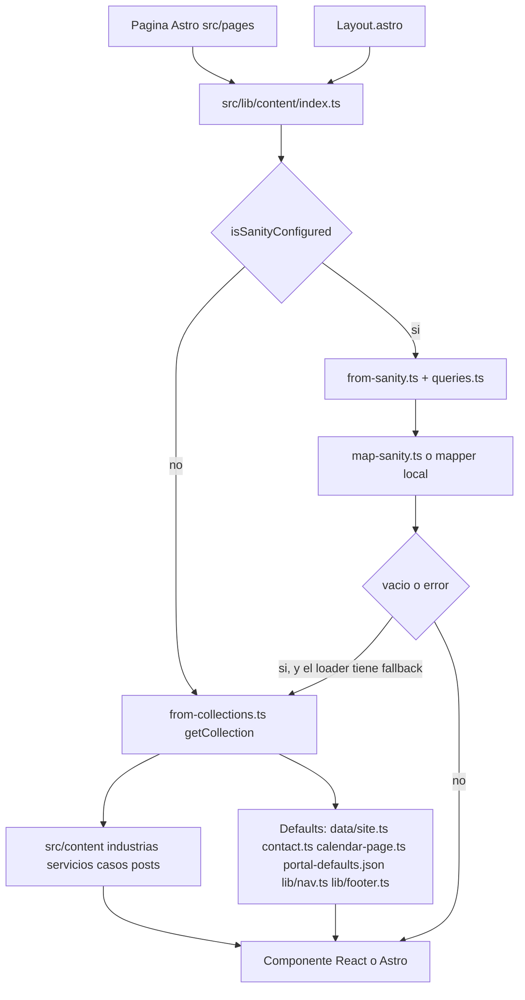
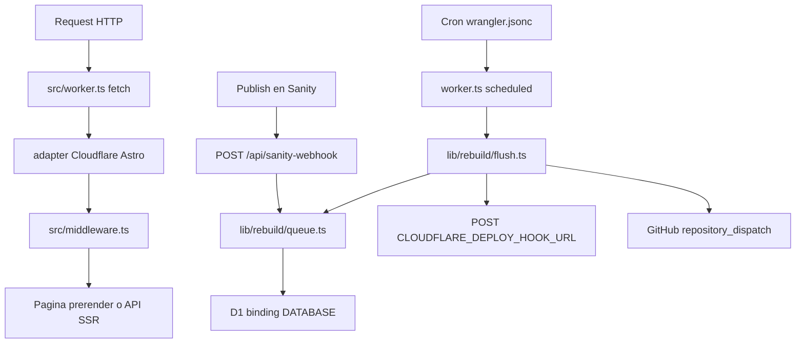
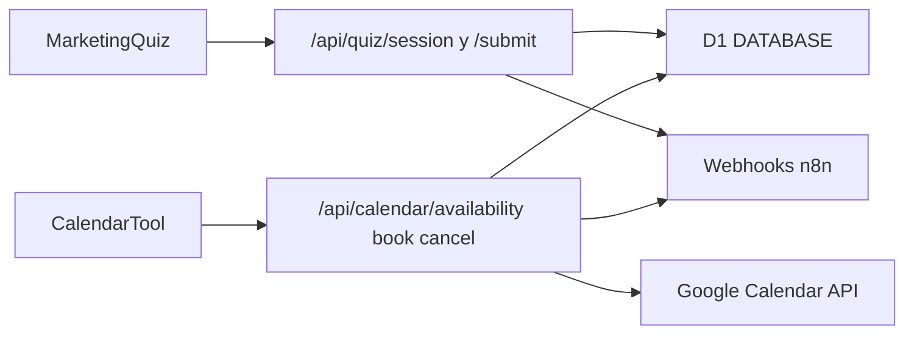

# Auditoría 01 — Arquitectura

Fecha de lectura: 2026-10-09. Solo código del repo. No se desplegó, no se consultó el dataset `web-2026` y no se ejecutó el sitio. Un campo “que no existe” aquí significa que el schema actual de `src/sanity/schemas` no lo define. GROQ no falla si el atributo falta: devuelve `null`. Documentos viejos en Sanity pueden seguir guardando campos que el schema ya quitó; eso no se comprobó contra el dataset.

Puerta de contenido: `src/lib/content/index.ts`. Queries: `src/sanity/queries.ts`. Carga: `src/lib/content/from-sanity.ts` (`loadQuery`). Forma de props: `src/lib/content/map-sanity.ts`, más mappers locales citados abajo. Respaldo de colecciones: `src/lib/content/from-collections.ts` sobre `src/content.config.ts`.

`withFallback` (`src/lib/content/index.ts` 53-69) usa Sanity si `isSanityConfigured()`. Si la llamada lanza, o si `isEmpty` dice que el valor viene vacío, vuelve al fallback. El aviso se imprime una sola vez (`src/lib/content/index.ts` 71-77).

---

## 1. Flujos

### Contenido: página → loader → Sanity o fallback → componente

Inglés de industrias, servicios, posts y el documento suelto de cada uno no entra a `withFallback`. Esas funciones llaman solo a Sanity (`src/lib/content/index.ts` 80-85, 151-152, 164-165, 173-174, 206, 210-211). Home, calendario, contacto y portal sí tienen red de seguridad, pero no siempre es `src/content`.

### Runtime: Worker, middleware, cron, webhook, D1

`src/worker.ts` 8-12: `fetch` delega en `@astrojs/cloudflare/entrypoints/server`. `scheduled` llama `flushDueRebuild` dentro de `waitUntil`.

`wrangler.jsonc` 20-22: el Worker live tiene cron `* * * * *`. El entorno `staging` tiene `"crons": []` (líneas 49-51). Son Workers distintos (`hiweb-marketing-ui` y `hiweb-marketing-ui-staging`) y bases D1 distintas (líneas 23-29 y 41-47).

Debounce: `REBUILD_DEBOUNCE_MS` es 10 minutos (`src/lib/rebuild/queue.ts` 5). El webhook no despliega. Solo hace `INSERT ... ON CONFLICT` en `rebuild_requests` (`src/lib/rebuild/queue.ts` 7-14, llamado desde `src/pages/api/sanity-webhook.ts` 46-53). El cron lee esa fila, espera a que pasen 10 minutos desde el último publish, borra la fila y entonces dispara (`src/lib/rebuild/queue.ts` 16-53). Si el disparo falla, reinserta la misma marca de tiempo y el siguiente minuto reintenta.

`canDispatchRebuild` (`src/lib/rebuild/dispatch.ts` 8-11) devuelve falso si `PUBLIC_SITE_ENV === 'staging'` o si no hay deploy hook ni token de GitHub. Orden de disparo: primero `POST` a `CLOUDFLARE_DEPLOY_HOOK_URL`; si no hay hook, `repository_dispatch` con `event_type: sanity-rebuild` (`src/lib/rebuild/dispatch.ts` 13-42). El repo por defecto del dispatch es `jahirgosu/hiweb-marketing-ui` (línea 28).

Auth del webhook: `Authorization: Bearer` contra `SANITY_REVALIDATE_SECRET` (`src/pages/api/sanity-webhook.ts` 32-36). `GET` solo responde que el servicio existe (líneas 60-62). `prerender = false` (línea 11).

`/api/rebuild-status` (`src/pages/api/rebuild-status.ts` 1-12) lee la cola y puede adelantar el deploy. También `prerender = false`. No se revisó la autorización del `POST` más allá del comentario del archivo.

Middleware (`src/middleware.ts`):

- Allowlist de `/en`. Cualquier otra ruta bajo `/en/` redirige a `/en` (líneas 44-57).
- En staging, y solo si la ruta no está prerenderizada, exige Basic Auth. Las rutas de draft mode y una cookie de presentación pueden pasar sin Basic (líneas 60-76).
- Staging pone `Cache-Control: no-store` y `frame-ancestors` hacia el Studio (líneas 84-88).
- `X-Robots-Tag` cuando `shouldNoIndex` (línea 89).

Build (`astro.config.mjs`):

- `output: 'server'` (línea 63) y adapter Cloudflare (líneas 80-84).
- En live, cada página con `export const prerender = true` sale a HTML.
- Si `PUBLIC_SITE_ENV === 'staging'`, `stagingSsr()` pone `prerender = false` en todas las rutas (líneas 37-53). El comentario de la línea 46 dice que staging es SSR para ver drafts sin rebuild.

D1 no es solo la cola de rebuild. El mismo binding `DATABASE` lo usan quiz y calendario (`src/lib/growth/db/d1.ts` 16-18). Migraciones en `migrations/d1/`: `quiz_sessions`, `quiz_leads`, `calendar_bookings` (`0001_quiz_calendar.sql`), índice único de slot confirmado (`0002`), columna `website` (`0003`), tabla `rebuild_requests` (`0004`).

---

## 2. Cadena por tipo de documento

Leyenda de fallback:

- **Colección**: `getCollection` en `from-collections.ts`. Solo existe para industrias, servicios, casos, posts, y el copy de home/about/personas armado con `src/data`.
- **Default**: objeto en código, no un archivo de `src/content`.
- **Ninguno**: si Sanity falla, la página recibe `null` o lanza.

No se listan campos anidados que sí coinciden. Solo desfaces comprobados schema contra query.

### home (`homePage`)

| Eslabón | Dónde |
|---|---|
| Schema | `src/sanity/schemas/homePage.ts` 5-36. Solo `sections` y `seoFields`. Secciones en `src/sanity/schemas/homeSections.ts`. |
| Query | `homePageQuery` y `homePageEnQuery` (`src/sanity/queries.ts` 366-512). Documento por `_id`: `homePage` y `homePage-en`. |
| Loader | `sanityHome` → `mapHome` (`src/lib/content/from-sanity.ts` 176-180, `src/lib/content/map-sanity.ts` 921-996). |
| API | `getHomeCopy` (`src/lib/content/index.ts` 231-251). Mezcla el resultado con `collectionsHome()` campo por campo. |
| Fallback | `collectionsHome()` (`src/lib/content/from-collections.ts` 158). Copy de `src/data/webflow-home.ts` y `src/data/site.ts`, no de un JSON de home. |
| Página | `src/pages/index.astro` y `src/pages/en/index.astro`. Importan `HeroStudioA`, `PillarGrid`, `ServiceGrid`, `IndustryGrid`, `CaseStories`, `ProcessPhases`, `MetricsBand`, `FaqSection`, `TeamGrid`, `BeforeAfter`, `FinalCta`. |

`getHomeCopy` sí usa `withFallback` en los dos idiomas. El schema no tiene `locale`; el inglés es otro documento.

Campos: las secciones definidas en `homeSections.ts` (`homeHero`, `homePillars`, `homeServices`, `homeIndustries`, `homeStories`, `homeProcess`, `homeMetrics`, `homeTeam`, `homeFaq`, `homeCta`) aparecen en la proyección, más `beforeAfter`. No vi un campo de esas secciones que la query omita, ni un campo de la query que el schema de home no tenga. `src/sanity/types.ts` alrededor de la línea 1241 todavía describe una query vieja con `heroTitle` y `heroLead` en la raíz del documento. Ese archivo no es el que ejecuta el sitio.

### service

| Eslabón | Dónde |
|---|---|
| Schema | `src/sanity/schemas/service.ts` 15-119: `nombre`, `slug`, `locale`, `orden`, `tagline`, `cardImage`, `cardIcon`, `cardIconImage`, `sections`, SEO. Secciones en `serviceSections.ts`. |
| Query | `servicesQuery` 777-808 y `serviceBySlugQuery` 810-839. |
| Loader | `sanityServices` / `sanityService` (`from-sanity.ts` 132-139) → `mapService` (`map-sanity.ts` 476-528). |
| API | `getServices` / `getService` (`index.ts` 164-184). |
| Fallback | `collectionsServices()` lee `src/content/servicios/*.json`. Solo en español. |
| Página | `src/pages/servicios/[slug].astro` y `src/pages/en/servicios/[slug].astro`: `IndustryHero`, `PillarGrid`, `ServiceFocus`, `ServicePitch`, `ServiceWhy`, `ServicePlans`, `IndustryGrid`, `ProcessPhases`, `CaseStories`, `FaqSection`, `FinalCta`, `ServicePageSection.astro`. |

Consultados y no definidos en el schema del documento (siguen en la query como respaldo plano; `mapService` los usa solo si vienen, y si no toma la sección):

- `heroTitle`, `heroDescription`, `heroImage`, `heroBadge`, `cards`, `proceso`, `faqs`
- `planesEyebrow`, `planesTitle`, `planesDescription`, `planesNote`, `planesNoteLabel`, `planesNoteHref`, `planesCtaLabel`, `planesCtaHref`, `planes`

Definidos y no consultados en el detalle: `cardImage` y `cardIcon` / `cardIconImage` sí salen en `servicesQuery` (líneas 784-785) y no salen en `serviceBySlugQuery` (líneas 810-832). `mapService` sí lee `doc.cardImage` y `doc.cardIcon` (líneas 509-510), así que el detalle los deja `undefined`.

Hay un script `scripts/sanity/unset-service-legacy-fields.ts`. No se comprobó si ya se corrió contra el dataset.

### industry

| Eslabón | Dónde |
|---|---|
| Schema | `src/sanity/schemas/industry.ts` 14-93: `nombre`, `slug`, `locale`, `orden`, `tagline`, `sections`, SEO. Secciones en `industrySections.ts`. |
| Query | `industriesQuery` 730-743 y `industryBySlugQuery` 745-758, con `industryBodyProjection` 686-728. |
| Loader | `sanityIndustries` / `sanityIndustry` (`from-sanity.ts` 76-99) → `mapIndustry` (`map-sanity.ts` 90). |
| API | `getIndustries` / `getIndustry` (`index.ts` 79-86 y 151-162). Inglés sin fallback. |
| Fallback | `collectionsIndustries()` lee `src/content/industrias/*.json` y cruza servicios para `serviceBlurbs`. |
| Página | `src/pages/industrias/[slug].astro` y `src/pages/en/industrias/[slug].astro`: `IndustryHero`, `IndustryServices`, `PillarGrid`, `CaseStories`, `FaqSection`, `FinalCta`, `IndustryPageSection.astro`. |

`industryBodyProjection` hace `coalesce` contra campos que el documento ya no define: `heroTitle`, `heroDescription`, `heroImage`, `heroBadge`, `heroCtaLabel`, `retos`, `porQue`, `whyEyebrow`, `whyTitle`, `servicesTitle`, `servicesDescription`, `servicesCtaLabel`, `servicesTag`, `casesEyebrow`, `casesTitle`, `casesDescription`, `casesEmpty`, `faqTitle`, `faqs`, `closingTitle`, `serviceBlurbs`. La proyección de `sections[]` (632-684) sí pide los campos que las secciones actuales definen (`industryHero`, `industryWhy`, `industryServices`, `industryCases`, `industryFaq`, `industryCta`, `beforeAfter`).

`industriesIndex` es otro tipo (`industry.ts` 111-139). Query `industriesIndexQuery` (760-775). Lo usa `getIndustriesIndex` y `src/pages/en/index.astro`. No hay página `/industrias`: `astro.config.mjs` 94-97 redirige `/industrias`, `/servicios`, `/en/industrias` y `/en/servicios` a home.

### caseStudy

| Eslabón | Dónde |
|---|---|
| Schema | `src/sanity/schemas/caseStudy.ts` 22-131: `cliente`, `slug`, `locale`, `industria`, `titulo`, `resumen`, `destacado`, `accent`, `sections`, SEO. `cards` es un fieldset, no un campo. Secciones en `caseSections.ts`. |
| Query | `casesQuery` 910-923 y `caseBySlugQuery` 925-938. Filtro fijo `coalesce(locale, "es") == "es"`. |
| Loader | `sanityCases` / `sanityCase` (`from-sanity.ts` 142-147) → `mapCase` (`map-sanity.ts` 698-761). |
| API | `getCases` / `getCase` (`index.ts` 186-200). Sí tienen fallback. No hay parámetro de idioma. |
| Fallback | `collectionsCases()` lee `src/content/casos/*.json` y, si el id existe en `WEBFLOW_CASES`, pisa el copy con `src/data/webflow-cases.ts` (`from-collections.ts` 72-105). |
| Página | `src/pages/portafolio/[slug].astro` y el índice `src/pages/portafolio/index.astro`. Detalle: `CaseTelescopeHero`, `BeforeAfter`, `ProcessPhases`, `MetricsBand`, `CaseStories`, `CaseCards`, `FinalCta`. No hay `src/pages/en/portafolio`. |

`caseBodyProjection` (899-907) pide en la raíz `metricas`, `reto`, `estrategia`, `fases`, `testimonio`, `anio`, `imagenesProyecto`. El schema no los define; viven en secciones. La query de `servicios` también hace `coalesce` contra un array `servicios` en la raíz del caso y contra `heroImage` del servicio (`queries.ts` 858 y 916). `service.ts` no tiene `heroImage`; el fallback interno `sections[_type == "serviceHero"][0].image` sí corresponde al schema.

`resultadoFrase` está en la colección (`content.config.ts` 54) y en `mapCase` (línea 727), pero no está en el schema de `caseStudy` ni en `casesQuery` / `caseBySlugQuery`. Con Sanity configurado, `mapCase` lo deja en `''`. Ninguna página ni componente de `src/pages` o `src/components` lee `resultadoFrase`. El fallback lo usa para el `metaTitle` (`from-collections.ts` 109).

### post

| Eslabón | Dónde |
|---|---|
| Schema | `src/sanity/schemas/post.ts`: documento `post` (título, `locale`, `esSlug`, `slug`, `description`, `keyword`, `author`, `autor`, `fecha`, `featured`, `readingMinutes`, categorías, `cover`, `body`, `faqs`) y documento `author`. |
| Query | `postsQuery` 940-959 (listado, incluye `readingMinutes` y `pt::text(body)` como `bodyText`, sin el body). `postBySlugQuery` 961-983 (incluye `body` y `alternateSlug` vía `esSlug`; no proyecta `readingMinutes` ni `bodyText`). |
| Loader | `sanityPosts` / `sanityPost` (`from-sanity.ts` 150-164) → `mapPost` (`map-sanity.ts` 763-818). |
| API | `getPosts` / `getPost` (`index.ts` 202-221). Fallback de posts solo en español. |
| Fallback | `collectionsPosts()` lee `src/content/posts/*.md`. Hay dos archivos. |
| Página | Índice: `src/pages/blog/index.astro` y `src/pages/en/blogs/index.astro` (`BlogHero`, `BlogIndex`). Artículo: `src/pages/blog/[slug].astro` y `src/pages/en/blogs/[slug].astro` (`BlogBody`, `BlogAuthorCard`, `BlogPostToc`, `FinalCta`). |

`readingMinutes` se define en el schema y el índice lo usa (`blog/index.astro` línea 40). El artículo no lo muestra (no hay coincidencias de `reading` en `blog/[slug].astro`). `author.slug` se define en `post.ts` línea 41 y la card del autor no lo pide.

### landingPage

| Eslabón | Dónde |
|---|---|
| Schema | `src/sanity/schemas/landingPage.ts` 30-103: `locale` (oculto, default `es`), `title`, `slug`, `templateKind`, `sections`, SEO. Bloques en `src/sanity/schemas/blocks/pageSections.ts`. |
| Query | `landingsQuery` 1023-1029 y `landingBySlugQuery` 1031-1063. Filtro fijo `locale == "es"`. |
| Loader | `sanityLandings` / `sanityLanding` (`from-sanity.ts` 597-601) → `mapLanding` / `mapLandingSection` (`map-sanity.ts` 1238 y 1574). |
| Hidratación | `hydrateLanding` (`src/lib/content/hydrate-landing.ts`) rellena catálogos cuando la sección no es `source: refs`. |
| API | `getLandings` / `getLanding` (`index.ts` 349-374). Fallback: array vacío. |
| Página | `src/pages/[slug].astro` → `SectionRenderer.astro`. |

`templateKind` (schema líneas 79-91) no está en ninguna de las dos queries.

`landingBySlugQuery` pide `industries[]->{ porQue[]{ title } }` (líneas 1048-1053). `industry.ts` no tiene `porQue`. `mapLandingSection` para `industryGrid` prefiere `cards`, que salen de `industryCardProjection` (puntos desde `sections[_type == "industryWhy"]`). El `porQue` solo se usaría si `cards` viene vacío y el array `industries` trae ese campo (`map-sanity.ts` 1307-1328). Con el schema actual ese array no trae bullets.

No hay ruta inglesa de landings. `locale` existe y está oculto en `es`.

### about (`aboutPage`)

| Eslabón | Dónde |
|---|---|
| Schema | `src/sanity/schemas/aboutPage.ts` 14-47: `locale`, `sections`, SEO. Secciones en `aboutSections.ts`. |
| Query | `aboutPageQuery` (`queries.ts` 595-630), ids `aboutPage` y `aboutPage-en`. |
| Loader | `sanityAbout` (`from-sanity.ts` 222-227) → `mapAbout` (`map-sanity.ts` 998-1040), que también llama `mapAboutSections`. |
| API | `getAboutCopy` (`index.ts` 308-312). Inglés: `(await sanityAbout('en')) ?? {}` sin colección. |
| Fallback | `collectionsAbout()` solo para español. |
| Página | `src/pages/nosotros.astro` y `src/pages/en/nosotros.astro`. Render real por `about.sections` (`nosotros.astro` 23-26) con `AboutPageSection.astro`, `IndustryHero`, `AboutHistory`, `PillarGrid`, `PresenceMap`, `PortalShowcase`, `TeamGrid`, `FinalCta`. |

La query plana hace `coalesce` contra campos de documento que el schema ya no tiene: `heroTitle`, `heroDescription`, `heroBadge`, `heroCtaLabel`, `heroCtaHref`, `heroImage`, `historyEyebrow`, `historyTitle`, `historyDescription`, `historyColumns`, `pillarsEyebrow`, `pillarsTitle`, `pillars`, `processEyebrow`, `processTitle`, `processDescription`, `teamEyebrow`, `teamTitle`, `teamDescription`, `teamCtaLabel`, `teamCtaHref`, `teamFilters`, `mapEyebrow`, `mapTitle`, `mapDescription`, `closingBadge`, `closingTitle`, `closingDescription`, `closingCtaLabel`. `aboutSectionsProjection` (514-593) sí pide los campos de `aboutHero`, `aboutHistory`, `aboutPillars`, `aboutProcess`, `aboutPortal`, `aboutTeam`, `aboutMap`, `aboutCta` y `beforeAfter`. La página de nosotros recorre `sections`.

### portal (`portalPage`)

| Eslabón | Dónde |
|---|---|
| Schema | `src/sanity/schemas/portalPage.ts` 269-296 y objetos `portalHero`, `portalStrip`, `portalJourney`, `portalBento`, `portalFaq`, `portalCloser`. |
| Query | `portalPageQuery` (`queries.ts` 1091-1144), ids `portalPage` y `portalPage-en`. |
| Loader | `sanityPortal` (`from-sanity.ts` 214-219) → `mapPortal` (`map-sanity.ts` 1453). |
| API | `getPortal` (`index.ts` 299-306). Si Sanity no está o falla, `null`. |
| Fallback | `src/lib/content/portal-defaults.json`, mezclado en la página, no en `from-collections.ts`. |
| Página | `src/pages/portal.astro` y `src/pages/en/portal.astro` → `PortalPageView`. |

Los campos de sección que leí en el schema están en la query. No marqué un desface aquí. `locale` se resuelve por `_id`, no se proyecta.

### contact (`contactPage`)

| Eslabón | Dónde |
|---|---|
| Schema | `src/sanity/schemas/contactPage.ts`. Incluye `...seoFields` (el archivo sigue después de los campos de formulario). |
| Query | `contactPageQuery` (`queries.ts` 1154-1179), id fijo `contactPage`. |
| Loader | `sanityContactPage` (`from-sanity.ts` 209-211) → `mapContactPage` en `src/lib/content/contact.ts` 90. |
| API | `getContactPage` (`index.ts` 290-297). |
| Fallback | `DEFAULT_CONTACT` en `src/lib/content/contact.ts`, no `src/content`. |
| Página | `src/pages/contacto.astro` → `ContactForm`. No hay `src/pages/en/contacto`. El formulario hace `mailto:` (`src/components/sections/ContactForm.tsx` línea 32). No pasa por n8n ni por D1. |

La query pide `metaTitle`, `metaDescription`, `noindex`, `canonicalPath`. `seoFields` también define `ogImage` (`src/sanity/schemas/shared.ts` 62). Esa imagen no está en `contactPageQuery`.

### legal (`legalPage`)

| Eslabón | Dónde |
|---|---|
| Schema | `src/sanity/schemas/legalPage.ts` 192 en adelante: `locale`, `eyebrow`, título, `updatedLabel`, `updatedOn`, `intro`, `sections`, más objetos `legalParagraph`, `legalBullets`, `legalTerms`, `legalLines`, `legalSubsection`. |
| Query | `legalPageQuery` (`queries.ts` 301-319). |
| Loader | `sanityLegalPage` (`from-sanity.ts` 521-535). El mapeo está en ese archivo, no en `map-sanity.ts`. |
| API | `getLegalPage` (`index.ts` 103-109). Vacío → `null`. |
| Fallback | Ningún JSON. La página tiene que tolerar `null`. |
| Página | `src/pages/terminos.astro`, `src/pages/aviso-de-privacidad.astro` y las pares en `src/pages/en/`. Componentes: `PageHero`, `LegalDocument`. |

La proyección de bloques coincide con los objetos del schema. No marqué campos fantasma.

### calendar (`calendarPage`)

| Eslabón | Dónde |
|---|---|
| Schema | `src/sanity/schemas/calendarPage.ts` 26-261, cierra con `...seoFields`. |
| Query | `calendarPageQuery` (`queries.ts` 1065-1089), ids `calendarPage` y `calendarPage-en`. |
| Loader | `sanityCalendarPage` (`from-sanity.ts` 201-206) → `mapCalendarPage` en `src/lib/content/calendar-page.ts` 154. |
| API | `getCalendarPage` (`index.ts` 280-288). |
| Fallback | `DEFAULT_CALENDAR` en `calendar-page.ts`. |
| Página | `src/pages/calendario.astro` y `src/pages/en/calendario.astro` → `CalendarTool`. |

Definidos en `seoFields` y no pedidos por esta query: `noindex`, `canonicalPath`, `ogImage`. Sí pide `metaTitle` y `metaDescription`.

### navigation

| Eslabón | Dónde |
|---|---|
| Schema | `src/sanity/schemas/navigation.ts` 236-274: `locale`, `bar` (`navBarItem`), `ctaLabel`, `ctaPage`, `ctaHref`. `navBarItem` (151-219): `label`, `kind` (`link` \| `dropdown`), `page`, `href`, `columns`, `indexLabel`, `indexPage`, `indexHref`. |
| Query | `navigationQuery` (`queries.ts` 208-240). |
| Loader | `sanityNavigation` (`from-sanity.ts` 582). El armado es `asBar` en el mismo archivo (279-324), no `map-sanity.ts`. |
| API | `getNavigation` (`index.ts` 135-141). Vacío → `null`. |
| Fallback | `SiteNav` usa `fallbackNav` de `src/lib/nav.ts` cuando el prop es null (`SiteNav.tsx` línea 23). Datos de `src/data/site.ts`. |
| UI | `src/layouts/Layout.astro` 40, componente `SiteNav`. |

La query pide campos que el schema del documento ya no tiene: `allIndustriesLabel`, `industriesIndexHref`, `allServicesLabel`, `servicesIndexHref`, `exploreHeading`, `industryLinks`, `serviceGroups`, `exploreLinks`. En cada ítem de `bar` pide `links`, `groups`, `exploreLinks` y `exploreHeading`, y `navBarItem` no los define. `asBar` todavía los lee como respaldo (líneas 281-320). Lo que el schema sí tiene (`columns`, `indexLabel`, `indexHref`, `ctaPage`) sí se consulta.

`navPagePath` (`queries.ts` 166-198) puede generar `/industrias` y `/servicios`. Esas rutas redirigen a home en `astro.config.mjs` 94-97.

### siteSettings

| Eslabón | Dónde |
|---|---|
| Schema | `src/sanity/schemas/siteSettings.ts` 7-83: `favicon`, `name`, `legalName`, `tagline`, `email`, `phone`, `phoneHref`, `whatsapp`, `locales`, `socials`. No hay grupo SEO. |
| Query viva | `siteIdentityQuery` 261-271 y `siteFaviconQuery` 321-325. |
| Query muerta | `siteSettingsQuery` 327-338 añade `seoProjection`. Nada en `src/` la ejecuta. Solo aparece el nombre en `src/sanity/types.ts` línea 553. |
| Loader | `sanitySiteIdentity` y `sanityFavicon` (`from-sanity.ts` 343-395). |
| API | `getSiteSettings` y `getFavicon` (`index.ts` 88-93 y 111-117). |
| Fallback | `fallbackSite()` en `src/lib/site-identity.ts`, desde `src/data/site.ts`. Favicon vacío → `null`. |
| UI | `Layout.astro` carga settings, favicon, nav y footer en todas las páginas. |

`siteIdentityQuery` coincide con el schema (el favicon va por la otra query). `siteSettingsQuery` pide `metaTitle`, `metaDescription`, `noindex`, `canonicalPath` y `ogImage`, que el schema no define.

El footer no está en la lista pedida, pero Layout lo carga junto con la nav. Schema `src/sanity/schemas/footer.ts`, query `footerQuery` (`queries.ts` 242-255), `getFooter` → `null` → `fallbackFooter` en `src/lib/footer.ts` 26, componente `SiteFooter`.

### Tipos vecinos que no pediste y sí existen

- `sitePage`: copy del diagnóstico. Schema `sitePage.ts`. Query `sitePageQuery` 1146-1152. Página `src/pages/diagnostico-marketing-digital.astro` (`PageHero` + `MarketingQuiz`). Fallback `SITE_PAGES` en `index.ts` 253-268.
- `person`: equipo. `peopleQuery` 985-995. `getPeople`. Fallback `collectionsPeople()` desde `TEAM_MEMBERS`.
- `catalogIndex` (`servicesIndex`, `blogIndex`, `casesIndex`): `catalogIndexQuery` 273-291. Índices de blog y portafolio. Fallback `null`.
- `redirect`: no pasa por `lib/content`. Lo aplica `integrations/sanity-redirects.mjs` en el build. No se auditó el contenido de esa integración.

---

## 3. Módulos de crecimiento

Quiz, calendario, n8n y D1 comparten el Worker. No comparten tablas. El formulario de contacto no entra en esta cadena.

### Quiz

- UI: `src/components/growth/MarketingQuiz` en `src/pages/diagnostico-marketing-digital.astro`. No hay página `/en` de diagnóstico. El copy de la página es `sitePage` `page-diagnostico`, no el resultado del quiz.
- Cliente: `src/lib/growth/quiz/client.ts` llama `/api/quiz/session` y `/api/quiz/submit`.
- Preguntas, puntaje y recomendaciones: `src/lib/growth/quiz/questions.ts`, `scoring.ts`, `result-levels.ts`, `service-recommendations.ts`, `validators.ts`.
- Sesión: `POST /api/quiz/session` (`src/pages/api/quiz/session.ts`) escribe `quiz_sessions`. Si D1 no responde, devuelve una sesión `ephemeral` en memoria de esa respuesta (líneas 44-50 y 73-78). Esa sesión no sobrevive otro request.
- Envío: `POST /api/quiz/submit` (`src/pages/api/quiz/submit.ts`) valida, puntúa, inserta `quiz_leads` y llama `dispatchQuizWebhook`.
- n8n: `dispatchQuizWebhook` (`src/lib/growth/n8n/client.ts` 72-78) hace `POST` JSON a `N8N_WEBHOOK_QUIZ_URL`, con header `X-Webhook-Secret` y `?secret=` si faltaba (`client.ts` 4-18 y 22-59). El cuerpo lo arma `buildQuizN8nPayload` (`src/lib/growth/n8n/payloads.ts` 14). El fallo del webhook se traga en `dispatchN8nWebhook` (líneas 62-69): el lead ya quedó en D1.

### Calendario

- UI: `CalendarTool` en `/calendario` y `/en/calendario`. El copy es `calendarPage`. Las reglas de horario (lun–vie, slots) están en `src/lib/growth/calendar/calendar-rules.ts` y los servicios ofrecidos en `src/lib/growth/calendar/services.ts` (parte de `NAV_SERVICES` en `src/data/site.ts`).
- Cliente: `src/lib/growth/calendar/client.ts` → `/api/calendar/availability`, `/book`, `/cancel`.
- Disponibilidad (`src/pages/api/calendar/availability.ts` → `getAvailabilityForDate`): reconcilia contra Google, lee ocupados en D1 y resta el free/busy de Google (`availability.ts` 31-40, `google-busy.ts`).
- Reserva (`src/pages/api/calendar/book.ts`): `createBooking` valida e inserta en `calendar_bookings` (`booking.ts` 7-29). Después espera el webhook n8n `calendar.booked`. Si n8n falla, la reserva igual se devuelve (el `try/catch` del API, líneas 15-19).
- Cancelación (`cancel.ts`): marca la fila y manda `calendar.cancelled`.
- Google: cuenta de servicio en `src/lib/growth/google/service-account-auth.ts`. Variables `GOOGLE_SERVICE_ACCOUNT_EMAIL`, `GOOGLE_SERVICE_ACCOUNT_PRIVATE_KEY`, `GOOGLE_CALENDAR_ID` (`src/lib/growth/shared/env.ts` 27-32). Este repo llama `freeBusy` y `events.list`. No hay `events.insert`. Crear el evento en el calendario de Google queda fuera de este código, en el flujo de n8n, si ese webhook está configurado.
- Reconcile (`reconcile-google.ts`): si el evento ya no está en Google, cancela la fila en D1. Si no hay credenciales, no hace nada. Si `events.list` falla, `googleCalendarEventExistsForBooking` devuelve `true` (`google-calendar-api.ts` 25-27 y 47-53), así que un error de Google no borra reservas.

### D1

Un binding, tres usos: sesiones y leads del quiz, reservas del calendario, y la fila única `rebuild_requests` / `pending`. Live y staging no comparten base (`wrangler.jsonc` 25-27 y 43-45). `getD1()` devuelve `null` si el binding no está (`d1.ts` 16-18). En local, sin el binding, el quiz cae a sesión efímera y el submit responde 503 si no puede insertar el lead (`quiz/submit.ts` 32-37).

---

## 4. Código muerto o legado

Búsqueda de imports en `src/` y `scripts/`. “Sin consumidores” significa que ningún archivo importa el símbolo o la ruta.

### Sin consumidores

- `src/components/Hero.tsx`. Exporta `Hero` (línea 8). No está en `src/components/sections/index.ts`. Ningún `.ts`, `.tsx` ni `.astro` lo importa. La home usa `HeroStudioA`.
- `src/assets/astro.svg`. El archivo existe. Ninguna referencia a `astro.svg` en el repo (búsqueda en ts, tsx, astro, js, mjs, css, svg, html, md).

### Tienen consumidor; no son código muerto

- `HeroStudioB` y `HeroSection`: los renderiza `src/components/sections/SectionsKitPage.tsx` (imports líneas 14-16, uso alrededor de 279-283). Esa página es `src/pages/sections.astro`. No los usa la home.
- `src/data/webflow-home.ts`, `webflow-services.ts`, `webflow-cases.ts`: los importa el runtime, no solo los scripts. `from-collections.ts` 4-6, `src/pages/index.astro` 16, `src/pages/en/index.astro` 16, `src/pages/portafolio/index.astro` 12 (`WEBFLOW_CASES_INDEX`), `HomeAfterHero.tsx`, `SectionsKitPage.tsx`. Los scripts `write-webflow-*.ts` también los importan.
- Todo `src/content/**`: las cuatro colecciones de `src/content.config.ts` (industrias, servicios, casos, posts) las lee `from-collections.ts` con `getCollection`. No hay otro directorio bajo `src/content`. No hay un JSON o MD de esa carpeta fuera de una colección. Se leen cuando el fallback corre, no en cada request si Sanity responde.

### Solo scripts (el sitio no los importa)

Busqué `scripts/sanity` dentro de `src/` y no hay imports. Son CLI. `package.json` 17-30 todavía expone `sanity:seed`, `sanity:import-posts`, `sanity:rebuild-tables`, `sanity:write-home`, `sanity:write-services`, `sanity:write-cases` y `sanity:migrate-home-sections`. El resto de `scripts/sanity/` (scrape, generate, seed-en, `unset-service-legacy-fields.ts`, `write-*-sections.ts`, etc.) no tiene script npm. No comprobé si alguien los corre a mano.

### Reexportados y no renderizados

`src/components/sections/index.ts` reexporta `HomePage` (61), `WorkPage` (63), `AboutTeaser` (26) y `ContactDetails` / `CalendarPlaceholder` (34). `SectionsKitPage.tsx` importa ese barrel, pero no esos símbolos, y ninguna página los usa en JSX. El barrel sí carga esos módulos al evaluarse. No son la home ni el contacto actuales. `HomePage.tsx` a su vez importa `HeroStudioA`.

---

## 5. Desfase docs contra código

### `docs/cms/README.md`

Línea 10: “Páginas públicas prerender. SSR solo para `robots.txt`, `sitemap.xml` y el webhook.”

En live, las páginas de marketing sí tienen `export const prerender = true` (todas las `.astro` de `src/pages`, más `diagnostico-marketing-digital.astro`, `design-system.astro`, `sections.astro`, `[slug].astro`). También son SSR, con `prerender = false`:

- `src/pages/robots.txt.ts` 4
- `src/pages/sitemap.xml.ts` 10
- `src/pages/api/sanity-webhook.ts` 11
- `src/pages/api/rebuild-status.ts` 12
- `src/pages/api/draft-mode/enable.ts` 10 y `disable.ts` 6
- `src/pages/api/quiz/session.ts` 9 y `submit.ts` 11
- `src/pages/api/calendar/availability.ts` 7, `book.ts` 8, `cancel.ts` 9

En staging no queda ninguna ruta prerender. `astro.config.mjs` 37-53 apaga `prerender` en el hook `astro:route:setup` cuando `PUBLIC_SITE_ENV=staging`.

Línea 36, bajo “Qué no se hace nunca”: “i18n ES/EN.”

Sí hay i18n. Páginas en `src/pages/en/`: `index`, `nosotros`, `portal`, `blogs/index`, `blogs/[slug]`, `servicios/[slug]`, `industrias/[slug]`, `calendario`, `terminos`, `aviso-de-privacidad`. El middleware las deja pasar (`middleware.ts` 44-54). Los schemas de servicio, industria, about, post, portal, calendario y nav tienen `locale`. Existen acciones de Studio `createEnglishVersion` / `ensureEnglishPair`. No hay inglés de contacto, portafolio, landings ni diagnóstico.

Línea 9 dice que Vercel ya no se usa. El adapter es Cloudflare. No vi un proyecto Vercel activo en esta lectura. La línea 37 todavía cita `hiweb-marketing-ui.vercel.app` como algo que no hay que indexar.

Línea 34 prohíbe “traer page builders (`splitHero`, `splitTabs`, etc.)”. El código ya tiene arrays `sections` en home, servicio, industria, about, caso, landing y portal. No son los objetos de Webflow nombrados en esa línea. El documento quedó atrás del modelo actual.

### `README.md` de la raíz

Línea 13: el sitio es `https://hiweb-marketing-ui.hiwebapps.workers.dev`. `wrangler.jsonc` 13 fija `PUBLIC_SITE_URL` en `https://hiweb.com.mx`. Staging es `https://staging.hiweb.com.mx` (línea 37). `docs/cms/OPS.md` 48 todavía pide `PUBLIC_SITE_URL=https://hiweb-marketing-ui.hiwebapps.workers.dev` en el env de build.

Línea 48: “Sin tokens el front sigue funcionando: las páginas prerender usan `src/content/` si Sanity no responde.” Cierto para el español de home, servicios, industrias, casos y posts, porque `withFallback` llama a `from-collections.ts`. Falso para inglés de esos tipos (no hay fallback), y falso para legal, contacto, calendario, portal, nav, footer y landings: su respaldo es código o `portal-defaults.json`, o `null`. `docs/cms/FASE-4.md` línea 21 repite la misma frase.

Línea 59: el webhook pega al deploy hook. El código encola en D1 y el cron dispara 10 minutos después (`sanity-webhook.ts` 1-4 y 52). `docs/cms/FASE-6.md` línea 7 dice lo mismo que el README (“webhook → Deploy Hook”). `docs/cms/OPS.md` 54 se acerca más: sin deploy hook el publish no regenera el HTML.

### Otras

- Repo del dispatch: código `jahirgosu/hiweb-marketing-ui` (`dispatch.ts` 28). README línea 11: `https://github.com/hiwebapps/hiweb-marketing-ui`. Si `GITHUB_DISPATCH_REPO` no está en el Worker, el respaldo pega al repo equivocado. No se leyeron los secrets del Worker.
- `src/sanity/types.ts` no coincide con `queries.ts`. El comentario de casos alrededor de las líneas 912 y 1247 todavía proyecta `resultadoFrase`, `metricas`, `reto` y `heroImage` en la raíz. El de home alrededor de 1241 todavía proyecta `heroTitle` en la raíz. El runtime usa los template strings de `queries.ts`, no ese archivo.
- Indexación: `wrangler.jsonc` 12 y 36 dejan `PUBLIC_SITE_INDEXABLE` en `false`. Eso sí coincide con README y `docs/cms/README.md`.

---

## 6. Hallazgos

### A-01. El inglés de catálogos no tiene fallback

- Severidad: Alta
- Archivo: `src/lib/content/index.ts:79-85`, `151-152`, `164-174`, `202-211`, `308-309`
- Evidencia: `getIndustries`, `getIndustry`, `getServices`, `getService`, `getPosts` y `getPost` con `locale === 'en'` llaman solo a Sanity. `getAboutCopy('en')` devuelve `{}` si `sanityAbout` viene vacío, sin `collectionsAbout()`. El español de esos tipos sí usa `withFallback`.
- Impacto: un token ausente, un dataset caído o un resultado vacío tumba el prerender de `/en/industrias/[slug]`, `/en/servicios/[slug]` y `/en/blogs`, o publica about en inglés vacío. El README dice que sin tokens el build sigue con `src/content`.
- Corrección propuesta: pasar el inglés por `withFallback` con un respaldo explícito (colección, documento español, o página 404 controlada). No dejar que la excepción salga del loader.
- Esfuerzo: medio

### A-02. Las queries de servicio, industria, about y caso piden campos que el schema ya quitó

- Severidad: Media
- Archivo: `src/sanity/queries.ts:595-630`, `686-728`, `777-839`, `899-938`; schemas `service.ts:15-119`, `industry.ts:14-93`, `aboutPage.ts:14-47`, `caseStudy.ts:22-131`
- Evidencia: el documento actual guarda el cuerpo en `sections`. Las queries siguen haciendo `coalesce` contra `heroTitle`, `cards`, `proceso`, `faqs`, `planes*`, `porQue`, `retos`, `metricas`, `reto`, `estrategia`, `fases`, `testimonio` y los campos planos de about listados en la sección 2. La proyección de `sections[]` sí coincide con los objetos nuevos. `mapService` y `mapCase` prefieren la sección si existe.
- Impacto: un editor que llena solo las secciones publica bien. Un agente que lea la query cree que el modelo plano sigue vivo. `serviceBySlugQuery` además omite `cardImage` y `cardIcon`, que el schema sí define y el listado sí pide (`queries.ts:784-785` frente a `810-832`).
- Corrección propuesta: borrar los `coalesce` de campos que el schema ya no tiene, después de confirmar en el dataset que ningún documento publicado depende de ellos. Añadir `cardImage` y `cardIcon` al query de detalle si la ficha los necesita.
- Esfuerzo: medio

### A-03. La query de la navbar pide el modelo viejo

- Severidad: Media
- Archivo: `src/sanity/queries.ts:208-240`; `src/sanity/schemas/navigation.ts:151-274`; `src/lib/content/from-sanity.ts:279-324`
- Evidencia: el schema tiene `bar[]` de `link` o `dropdown` con `columns`. La query también pide `industryLinks`, `serviceGroups`, `exploreLinks`, `allIndustriesLabel`, `industriesIndexHref`, `allServicesLabel`, `servicesIndexHref`, `exploreHeading`, y dentro de cada ítem `links`, `groups` y `exploreLinks`. `asBar` todavía arma columnas con esos campos si `columns` viene vacío.
- Impacto: con documentos nuevos, el menú sale de `columns` y el resto llega `null`. Si un documento se migró a medias, el fallback silencioso puede mezclar columnas viejas. No se leyó el documento publicado.
- Corrección propuesta: dejar la query en `bar`, `ctaLabel`, `ctaPage`, `ctaHref`. Quitar el respaldo de `asBar` cuando el dataset ya no tenga esos campos.
- Esfuerzo: bajo

### A-04. Los docs niegan el i18n y reducen el SSR a tres rutas

- Severidad: Alta
- Archivo: `docs/cms/README.md:10`, `docs/cms/README.md:36`; contraste en `src/pages/en/**`, `src/middleware.ts:44-57`, `astro.config.mjs:37-53`, y las rutas con `prerender = false` listadas en la sección 5
- Evidencia: el README del CMS dice que no hay i18n y que solo `robots.txt`, `sitemap.xml` y el webhook son SSR. El repo tiene diez páginas bajo `src/pages/en/`, schemas con `locale`, y ocho endpoints SSR además de robots, sitemap y webhook. Staging fuerza SSR en todas las rutas.
- Impacto: otro agente puede borrar `/en`, o prerenderizar quiz y calendario, o esperar HTML estático en staging.
- Corrección propuesta: reescribir esas dos líneas. Decir qué rutas son prerender en live, cuáles son SSR siempre, y que staging no prerenderiza. Sacar “i18n ES/EN” de la lista de prohibiciones, o acotar la prohibición a lo que de verdad no existe (contacto, portafolio y landings en inglés).
- Esfuerzo: bajo

### A-05. Casos y landings están fijos en español aunque el schema tiene idioma

- Severidad: Media
- Archivo: `src/sanity/queries.ts:910-912`, `925-927`, `1023-1025`, `1031-1033`; `src/sanity/schemas/caseStudy.ts:53-66`; `src/sanity/schemas/landingPage.ts:31-45`
- Evidencia: `caseStudy` y `landingPage` definen `locale`. Las cuatro queries filtran `coalesce(locale, "es") == "es"`. No hay `src/pages/en/portafolio` ni ruta inglesa para landings. `landingPage.locale` además está `hidden: true` con `initialValue: 'es'`.
- Impacto: un caso marcado English no tiene URL. Una landing en inglés tampoco. El filtro evita publicarlas por error en las rutas españolas, y también las esconde.
- Corrección propuesta: decidir si el inglés de casos y landings entra al alcance. Si no, quitar `locale` del caso o documentar que es español only. Si sí, parametrizar la query y añadir la ruta.
- Esfuerzo: medio

### A-06. `resultadoFrase` no viaja de Sanity a la página

- Severidad: Baja
- Archivo: `src/content.config.ts:54`; `src/lib/content/map-sanity.ts:727`; `src/sanity/schemas/caseStudy.ts:22-131`; `src/sanity/queries.ts:910-938`
- Evidencia: el JSON de casos exige `resultadoFrase`. `mapCase` lo lee. El schema y la query de `caseStudy` no lo tienen. Ningún componente de página lo renderiza. El fallback lo mete en el `metaTitle` (`from-collections.ts` 109).
- Impacto: con Sanity activo la frase de resultado del JSON no aparece. El título SEO del caso usa los campos SEO del documento, no esa frase.
- Corrección propuesta: o se agrega el campo al schema, a la query y a la card del portafolio, o se quita de `mapCase` y de la colección cuando el fallback ya no haga falta.
- Esfuerzo: bajo

### A-07. El dispatch de respaldo apunta a otro repo de GitHub

- Severidad: Media
- Archivo: `src/lib/rebuild/dispatch.ts:26-36`; `README.md:11`
- Evidencia: si no hay `CLOUDFLARE_DEPLOY_HOOK_URL`, el código hace `POST` a `https://api.github.com/repos/${githubRepo}/dispatches` con default `jahirgosu/hiweb-marketing-ui`. El README identifica el repo como `hiwebapps/hiweb-marketing-ui`.
- Impacto: sin deploy hook y sin `GITHUB_DISPATCH_REPO`, el cron marca el rebuild como fallido y reintenta cada minuto (`queue.ts` 43-51). No se inspeccionaron los secrets del Worker, así que no sé si el hook ya está puesto.
- Corrección propuesta: cambiar el default al repo `hiwebapps/hiweb-marketing-ui`, o no tener default y exigir la variable.
- Esfuerzo: bajo

### A-08. `siteSettingsQuery` pide SEO que el schema no tiene y nadie la ejecuta

- Severidad: Baja
- Archivo: `src/sanity/queries.ts:327-338`; `src/sanity/schemas/siteSettings.ts:7-83`
- Evidencia: la query añade `seoProjection` (`metaTitle`, `metaDescription`, `noindex`, `canonicalPath`, `ogImage`). El schema no define esos campos. `src/lib/content/from-sanity.ts` usa `siteIdentityQuery` (261-271) y `siteFaviconQuery` (321-325). La única otra mención es un comentario en `src/sanity/types.ts:553`.
- Impacto: ninguna página lee esa query. Confunde al typegen y al siguiente editor.
- Corrección propuesta: borrar `siteSettingsQuery` y regenerar `src/sanity/types.ts`.
- Esfuerzo: bajo

### A-09. Calendario y contacto no proyectan todo el SEO del schema

- Severidad: Baja
- Archivo: `src/sanity/queries.ts:1065-1089` y `1154-1179`; `src/sanity/schemas/shared.ts:43-86`; `calendarPage.ts:261`; el spread de `seoFields` en `contactPage.ts`
- Evidencia: `seoFields` incluye `ogImage`, `noindex` y `canonicalPath`. `calendarPageQuery` solo pide `metaTitle` y `metaDescription`. `contactPageQuery` pide noindex y canonical, y no pide `ogImage`.
- Impacto: un og:image o un noindex editado en el calendario no llega a la página. El contacto no puede cambiar la imagen social desde Studio.
- Corrección propuesta: usar `seoProjection` en las dos queries, igual que en legal y home.
- Esfuerzo: bajo

### A-10. `templateKind` de la landing no se consulta

- Severidad: Baja
- Archivo: `src/sanity/schemas/landingPage.ts:78-91`; `src/sanity/queries.ts:1023-1063`
- Evidencia: el campo existe (`serviceLite`, `industryLite`, `campaign`) y sirve de `initialValue` de secciones. `landingsQuery` y `landingBySlugQuery` no lo proyectan. El render usa `sections`, no la plantilla.
- Impacto: cambiar la plantilla en Studio no reordena una página ya guardada. El front no puede distinguir el tipo. Puede ser intencional.
- Corrección propuesta: proyectarlo solo si alguna página lo necesita. Si es solo semilla del Studio, decirlo en la descripción del campo.
- Esfuerzo: bajo

### A-11. `Hero.tsx` y `astro.svg` no tienen consumidores

- Severidad: Baja
- Archivo: `src/components/Hero.tsx:8`; `src/assets/astro.svg`
- Evidencia: búsqueda de imports de `Hero` y de la cadena `astro.svg` en el repo. Cero referencias fuera del propio componente. La home monta `HeroStudioA` (`src/pages/index.astro:5`).
- Impacto: ruido para quien busque el hero del sitio. No afecta el render.
- Corrección propuesta: borrar los dos archivos cuando se acepte limpiar legado. No tocar `HeroStudioA`, `HeroStudioB` ni `HeroSection`: esos sí tienen página (`/sections` o la home).
- Esfuerzo: bajo

### A-12. `src/sanity/types.ts` describe queries que ya no existen

- Severidad: Media
- Archivo: `src/sanity/types.ts:912`, `1241`, `1247-1248`; contraste con `src/sanity/queries.ts` actual
- Evidencia: los comentarios de typegen todavía muestran casos con `resultadoFrase` y `metricas` en la raíz, y home con `heroTitle` / `heroLead` en la raíz. `package.json` 16 define `sanity:typegen`. El fetch real usa `defineQuery` en `queries.ts`.
- Impacto: un agente que tipa contra `types.ts` escribe mappers para un modelo retirado.
- Corrección propuesta: correr el typegen del repo después de limpiar las queries, y no editar `types.ts` a mano.
- Esfuerzo: bajo

### A-13. El publish no actualiza el HTML de live al momento

- Severidad: Media
- Archivo: `src/pages/api/sanity-webhook.ts:1-4` y `46-53`; `src/lib/rebuild/queue.ts:4-5` y `16-26`; `wrangler.jsonc:20-22` y `49-51`; `src/lib/rebuild/dispatch.ts:8-11`
- Evidencia: el webhook solo inserta `rebuild_requests`. El cron de live corre cada minuto y no dispara hasta 10 minutos después del último publish. Staging tiene la lista de crons vacía y `canDispatchRebuild` rechaza `PUBLIC_SITE_ENV=staging`. Staging no necesita ese rebuild para ver contenido, porque `stagingSsr()` apaga el prerender. Live sí lo necesita, porque las páginas salen a HTML en el build.
- Impacto: un publish en Sanity tarda como mínimo diez minutos en verse en hiweb.com.mx, y solo si el deploy hook o el token de GitHub existen. Varios publishes seguidos reinician el reloj. Los docs de fase 6 lo cuentan como llamada directa al hook.
- Corrección propuesta: documentar el debounce en `docs/cms/OPS.md` y en el README. Corregir el default del repo (A-07). No añadir cron a staging mientras el staging siga siendo SSR.
- Esfuerzo: bajo

### A-14. La frase “sin tokens se usa src/content” no cubre medio sitio

- Severidad: Media
- Archivo: `README.md:48`; `docs/cms/FASE-4.md:21`; `src/lib/content/index.ts:103-109`, `280-306`, `349-351`
- Evidencia: legal, portal, contacto, calendario, nav, footer y landings no leen `src/content`. Portal cae a `portal-defaults.json`. Contacto y calendario caen a constantes. Legal y landings caen a `null` o `[]`. Nav y footer caen a `src/data/site.ts` dentro del componente.
- Impacto: un build sin token no reproduce el sitio completo. Legal y landings salen vacías. El diagnóstico sigue, porque `getSitePage` tiene `SITE_PAGES` en código (`index.ts` 253-268).
- Corrección propuesta: en el README, listar qué tipos tienen colección, cuáles tienen default en código y cuáles requieren Sanity.
- Esfuerzo: bajo
