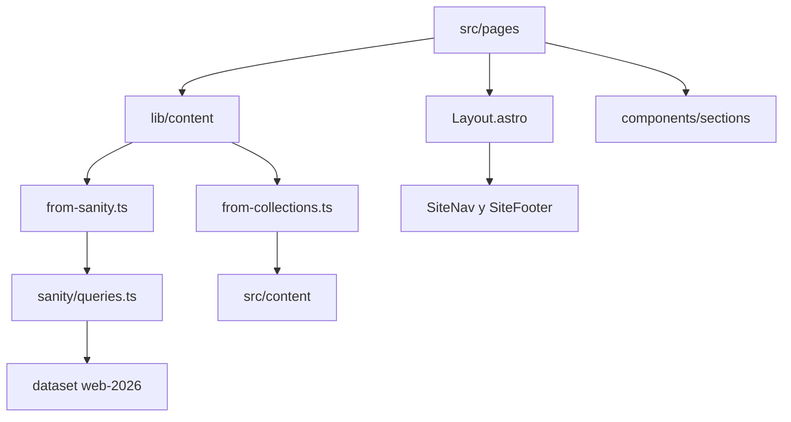
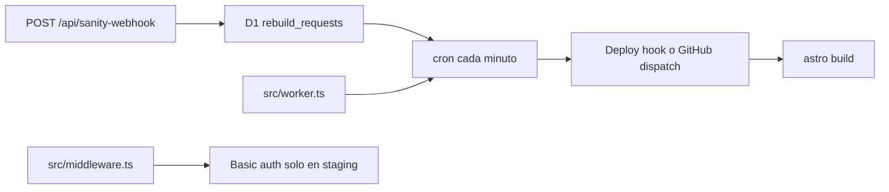

# Cómo está armado este repo

Sitio de Hiweb: Astro 7, React 19, Sanity 6 y Cloudflare Workers. El diseño vive en los componentes. El copy, las listas y las imágenes viven en el dataset `web-2026` del proyecto `fxardjr1`. Si Sanity no responde en el build, varias páginas caen a `src/content`.

Esta carpeta es el mapa para un agente. La auditoría (qué está mal) está en [../audit/README.md](../audit/README.md). El grafo mecánico de imports está en [grafo.md](./grafo.md).

## Por dónde entrar

| Si vas a tocar… | Lee |
| --- | --- |
| Una URL | [pages.md](./pages.md) y [pages-api.md](./pages-api.md) |
| Una sección visual | [components-sections.md](./components-sections.md) |
| Un botón, un input | [components-ui.md](./components-ui.md) |
| Portal, efectos, quiz en pantalla | [components-resto.md](./components-resto.md) |
| De dónde sale el copy | [lib-content.md](./lib-content.md) |
| Calendario, diagnóstico, n8n, D1 | [lib-growth.md](./lib-growth.md) |
| SEO, idioma, rebuild, preview | [lib-plataforma.md](./lib-plataforma.md) |
| Un campo del Studio | [sanity-schemas.md](./sanity-schemas.md) |
| El desk, las queries, Presentation | [sanity-studio.md](./sanity-studio.md) |
| Un script `sanity:*` o una migración D1 | [scripts.md](./scripts.md) |
| Build, Worker, middleware, layout | [runtime.md](./runtime.md) |

## Flujo de una página

En live, la página con `prerender = true` se vuelve HTML en el build. En staging, `stagingSsr()` en `astro.config.mjs` apaga ese prerender para que un draft de Sanity se vea sin rebuild. Las APIs (`/api/calendar`, `/api/quiz`, webhook, draft mode) nunca se prerenderizan.

## Runtime

El cron está en el Worker de live (`wrangler.jsonc`). Staging no tiene cron y no dispara deploys.

## Glosario

| Término | Qué es |
| --- | --- |
| `landingPage` | Página suelta en `/[slug]`, armada con bloques. No es un servicio ni una industria. |
| `sitePage` | Documento de una URL fija que no tiene colección (el diagnóstico). |
| Sección | Un objeto del array `sections` (por ejemplo `homeHero`, `servicePlans`). El schema está en `*Sections.ts`. La página elige el componente. |
| Fallback | JSON o Markdown en `src/content`. `withFallback` en `lib/content/index.ts` lo usa si Sanity falla o viene vacío. El inglés de varios catálogos no tiene este respaldo. |
| Rebuild queue | Una fila en D1. El webhook la marca. El cron, pasados unos minutos, llama al deploy hook. |
| Par ES/EN | En servicios, industrias y posts, el documento inglés suele ser el mismo `_id` con sufijo `-en`. El selector de idioma, en cambio, usa mapas en `en-slugs.ts` y `blog-pairs.ts`. No es la misma fuente. |
| Stega | Metadatos de Visual Editing. Está apagado en el build (`stega.enabled: false`). Los drafts se ven en staging por SSR, no por overlays en el HTML de live. |
| `PUBLIC_SITE_INDEXABLE` | Flag de noindex. Hoy no basta con ponerlo en `true`: también mandan el host y `public/_headers`. Ver S-01. |

## Cómo leer un archivo

1. La ficha del módulo dice para qué existe y quién lo importa.
2. Si el archivo es una página, el prerender y el `client:*` importan más que el JSX.
3. Si toca copy, sigue schema → query en `queries.ts` → mapper en `map-sanity.ts` → componente. Un campo que solo existe en uno de esos cuatro sitios está huérfano.
4. Los hallazgos enlazan a un id (`S-01`, `G-01`, `C-02`). El detalle y la corrección están en `docs/audit/`, no hay que repetirlos aquí.

## Qué no está en el diseño actual

`Hero.tsx`, `HeroSection` y `HeroStudioB` no son el hero de la home. La home usa `HeroStudioA`. `src/assets/astro.svg` es el residuo de la plantilla de Astro. `fonts/` en la raíz (Roboto Serif, Syne, DM Sans) no lo pide `global.css`. Las fuentes que sí se sirven están en `public/fonts`.
